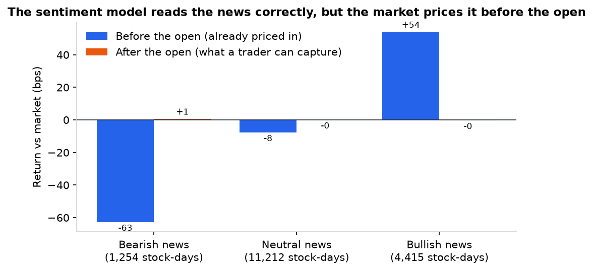
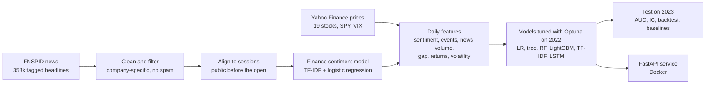
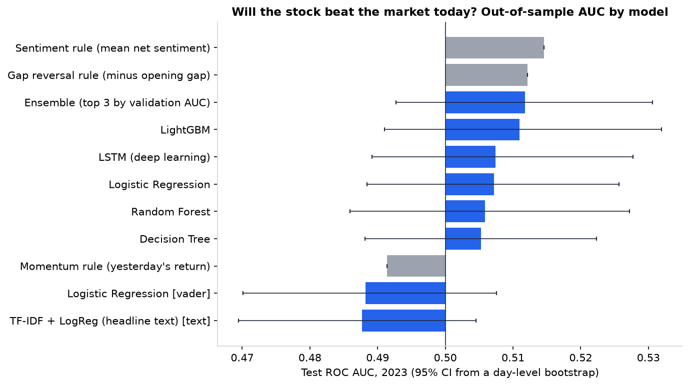
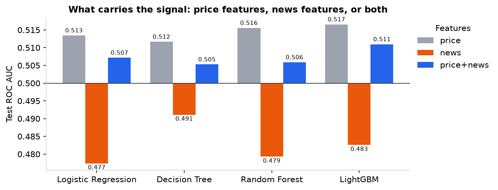
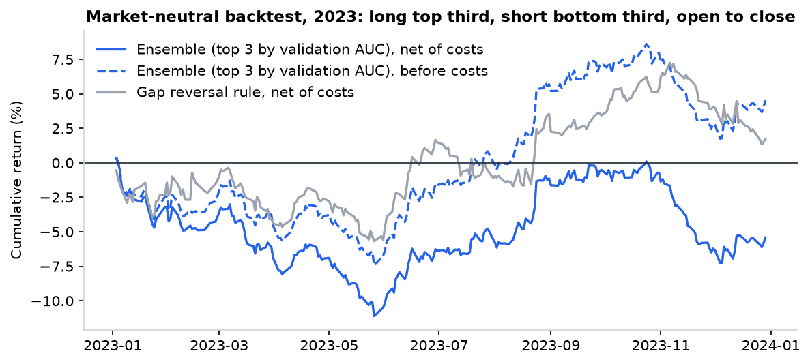
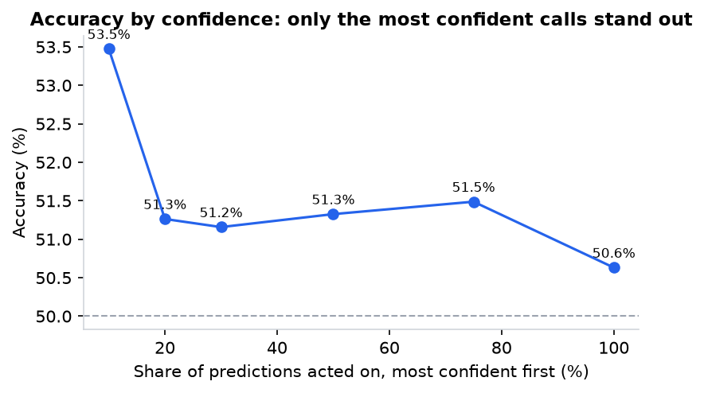
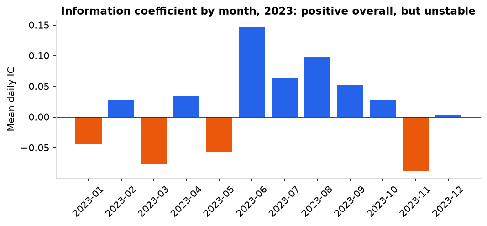

# Stock Movement Prediction from Company News

[](https://github.com/RahulSingh005/Stock-Sentiment-Analysis-Using-Machine-Learning/actions/workflows/ci.yml)

Can company news headlines predict how a stock moves the next trading day? This project answers that end to end: a finance sentiment model, a leak-free daily dataset for 19 Nasdaq stocks (2017–2023), tuned ML and deep-learning models, a cost-aware backtest, and a FastAPI service that scores new headlines.

It started as an IIT Roorkee Finance Club project. The first version reported 98% accuracy, which turned out to be leakage, so I rebuilt it to the standard I would expect from production research: no look-ahead, a held-out test year, baselines for every claim, and tests that enforce all of it.

## Key results

- **The sentiment model reads market-moving news well.** It is a TF-IDF + logistic regression classifier with **82.5% accuracy** (3 classes) on held-out financial headlines. On days with bullish company news, stocks had already beaten the market by **+54 bps** by the next open; on bearish days they lagged by **−63 bps** (t = 14.0, 16,881 stock-days).
- **That move is priced in before anyone can trade it.** From the open to the close the difference is ~0 bps, and every predictive model lands near chance on the 2023 test year (best AUC **0.517**; the model picked on validation scores **0.512**, 95% CI 0.493–0.531).
- **The small edge that exists does not survive costs.** A market-neutral long-short strategy earns **+4.6% a year before costs (Sharpe 0.64)** but loses money at a realistic 2 bps per trade.



In short, the sentiment signal is real and the market is fast. That is the honest answer to the original question, and the pipeline below is built so the answer can be trusted.

## The prediction problem

Most FNSPID timestamps have a date but no time of day, so a headline dated Monday could have come out after Monday's close. Using it to predict Monday-close to Tuesday-close would leak the future. The setup therefore mirrors what a trader could actually do:

- **When:** before each session opens.
- **Inputs:** every company headline dated up to the previous day, prices up to the previous close, and the opening gap.
- **Target:** does the stock **beat the market (SPY) from today's open to today's close**? Company news can explain the company-specific part of a move, not whether the whole market rises, so the target is market-relative.
- **Split by time:** train 2017–2021 (19,642 stock-days), tune on 2022 (4,769), test once on 2023 (4,750).

## Pipeline



**Data.** FNSPID (Nasdaq-100 subset) maps each article to a ticker. I keep only headlines that name the company or its ticker, drop auto-generated items (13F holdings, options-activity, ETF listicles) and duplicates, leaving 45,331 headlines. Each stock enters the panel when its coverage starts (Google 2019, Apple, Microsoft and Tesla 2022), so a year with no data is never mistaken for a quiet year.

**Features.** Per stock and session:
- Sentiment from the finance model and from VADER (as a baseline).
- Event flags pulled from headlines: upgrades, downgrades, earnings beats and misses, legal news.
- News volume, and how unusual it is against the prior 20 sessions.
- Price context: opening gap, past returns, volatility, RSI, the market's move, and VIX.

**Models.** Every model is tuned with Optuna on the 2022 validation year (40 trials each, 20 for the LSTM, maximising ROC AUC), refit on 2017–2022, and scored once on 2023:

| Model | Inputs | Notes |
|---|---|---|
| Logistic regression | price / news / both | L1 or L2, tuned C |
| Decision tree | price / news / both | depth, leaf size, criterion |
| Random forest | price / news / both | trees, depth, leaf size, feature fraction |
| LightGBM | price / news / both | leaves, learning rate, sampling, regularisation |
| TF-IDF + logistic regression | raw headline text | the classic bag-of-words approach, without leakage |
| LSTM (PyTorch) | last 5–20 sessions of features | sequence length, width, layers, dropout, learning rate |
| Ensemble | top 3 models by validation AUC | probability average |

## Results on 2023 (never touched during development)



| Metric (model chosen on validation: ensemble) | Value |
|---|---|
| ROC AUC | 0.512 (95% CI 0.493–0.531, day-level bootstrap) |
| Accuracy | 50.6% overall, 53.5% on the 10% most confident calls |
| Daily information coefficient | +0.015 (t = 0.9) |
| Long-short Sharpe, before / after costs | +0.64 / −0.72 |

What the results say:

- **Price context carries what little signal there is.** Price-only models are the most stable (test AUC 0.512–0.517). A large opening gap tends to partly reverse during the day, and a one-line "gap reversal" rule is as good as most models.
- **News-only models learned a relationship that flipped.** They looked useful on 2022 (AUC 0.52) but scored 0.48–0.49 on 2023. Meanwhile, the fixed rule "higher sentiment, higher return" had a real 2023 signal (IC +0.037, t = 2.5). The relationship between news tone and next-session returns is weak and changes with the market regime.
- **Deep learning does not change the picture.** The LSTM (0.507) and the bag-of-words model (0.488) do no better than trees on this much data.





The backtest buys the top third and shorts the bottom third of stocks each morning, closes at the bell, and charges costs on both sides. The gross edge is +4.6% a year; at 1 bp per side it breaks even, and at 2 bps it loses 5.5% a year. Full tables, including every model, baseline and cost level, are in [reports/results.md](reports/results.md).

<p float="left">
  
  
</p>

## Using the API

```bash
pip install -e ".[api]"
stocksent serve          # interactive docs at http://localhost:8000/docs
```

```bash
curl -X POST http://localhost:8000/predict -H "Content-Type: application/json" -d '{
  "ticker": "MSFT",
  "headlines": [
    {"title": "Microsoft beats estimates on cloud strength", "published_at": "2026-10-29"},
    {"title": "Microsoft cut to Neutral at UBS", "published_at": "2026-10-30T11:15:00Z"}
  ]
}'
```

The service downloads recent prices if none are sent, applies the same session rules as training (only news public before the open counts), and returns the probability that the stock beats the market today with per-headline sentiment:

```json
{"ticker": "MSFT", "session": "2023-10-25", "probability_beats_market": 0.48, "signal": "underperform",
 "headlines_used": 14, "opening_gap": 0.043, "model": "Random Forest", "trained_through": "2022-12-31",
 "headline_scores": [{"title": "Microsoft (MSFT) Q1 Earnings and Revenues Beat Estimates", "bullish": 0.67, "bearish": 0.18, "neutral": 0.16}]}
```

`POST /sentiment` scores a list of headlines on its own, and `GET /health` reports the loaded model. The service also ships as a container:

```bash
docker build -t stocksent .
docker run -p 8000:8000 stocksent
```

## Engineering

- **One package, one CLI.** `stocksent ingest | features | train | report | all | serve`, driven by [configs/default.yaml](configs/default.yaml). Raw downloads are cached, so reruns are fast.
- **Training and serving share code.** The API builds features with the same functions as the training pipeline, so the two cannot drift apart.
- **Tests guard the assumptions that matter.** These include: features do not change when anything after the open changes; news after the open waits for the next session; date-only stamps are handled conservatively; backtest costs are charged on both sides; the API serves only pre-open news. CI runs ruff and pytest on Python 3.10–3.12.
- **Runs on a small laptop.** The full pipeline runs in about 30 minutes on 4 GB of RAM, including the first data download; thread pools are capped to keep memory flat.

## Reproduce

```bash
pip install -e ".[dl,api,dev]"
stocksent all            # ingest -> features -> train -> report
pytest -q
```

## Project layout

```
configs/default.yaml        universe, dates, costs, tuning budget
src/stocksent/
  data/                     FNSPID news, Yahoo prices, session alignment
  features/                 sentiment model, news and market features, dataset assembly
  models/                   tuned classical models, LSTM
  evaluation/               metrics (AUC CI, IC, confidence), backtests
  pipeline.py, report.py    stages and the results report
  inference.py, api/        live scoring and the FastAPI app
models/                     trained sentiment model and production classifier
reports/                    results.md, metrics.json, figures
tests/                      pytest suite
legacy/                     the original 2023 notebooks and data
```

## Limitations and next steps

- **Timestamps:** most are dates only, which forces a conservative one-session delay. Intraday news times would allow a fairer test of how fast prices react.
- **Scope:** 19 large Nasdaq stocks, one test year, and a universe chosen with hindsight (survivorship bias). More stocks and years would tighten the confidence intervals.
- **Next experiments:** walk-forward retraining each year to adapt to regime changes, and multi-day horizons where post-earnings drift is documented.

## Version history

The first version (in `legacy/`) predicted a "movement" label that was computed from the model's own sentiment inputs, and estimated same-day prices from same-day highs and lows. Both inflate accuracy without any predictive power. The current version replaces that with the time-aware setup above.

## References and data

- Dong et al. (2024), *FNSPID: A Comprehensive Financial News Dataset in Time Series*, KDD. Used through the [Nasdaq-100 subset on Hugging Face](https://huggingface.co/datasets/benstaf/FNSPID-filtered-nasdaq-100).
- [zeroshot/twitter-financial-news-sentiment](https://huggingface.co/datasets/zeroshot/twitter-financial-news-sentiment) (MIT), used to train the finance sentiment model.
- Hutto and Gilbert (2014), *VADER: A Parsimonious Rule-based Model for Sentiment Analysis of Social Media Text*, ICWSM.
- Prices from Yahoo Finance via `yfinance`.
