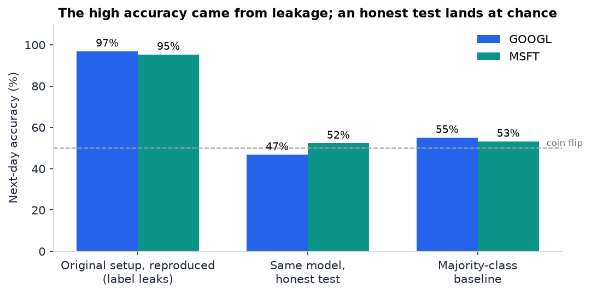
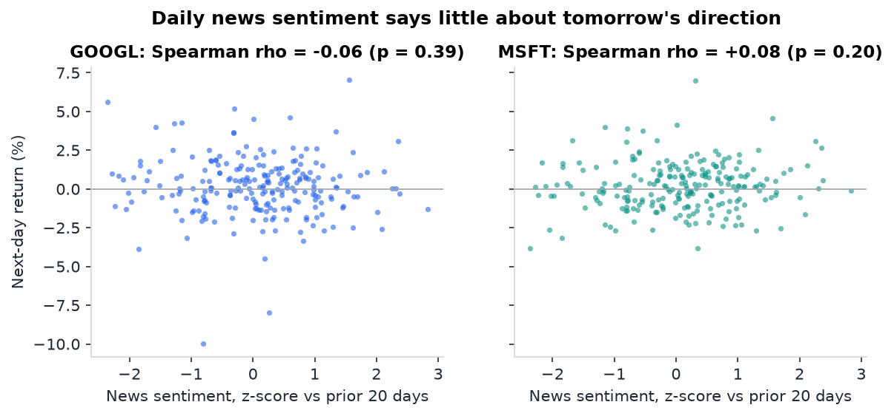
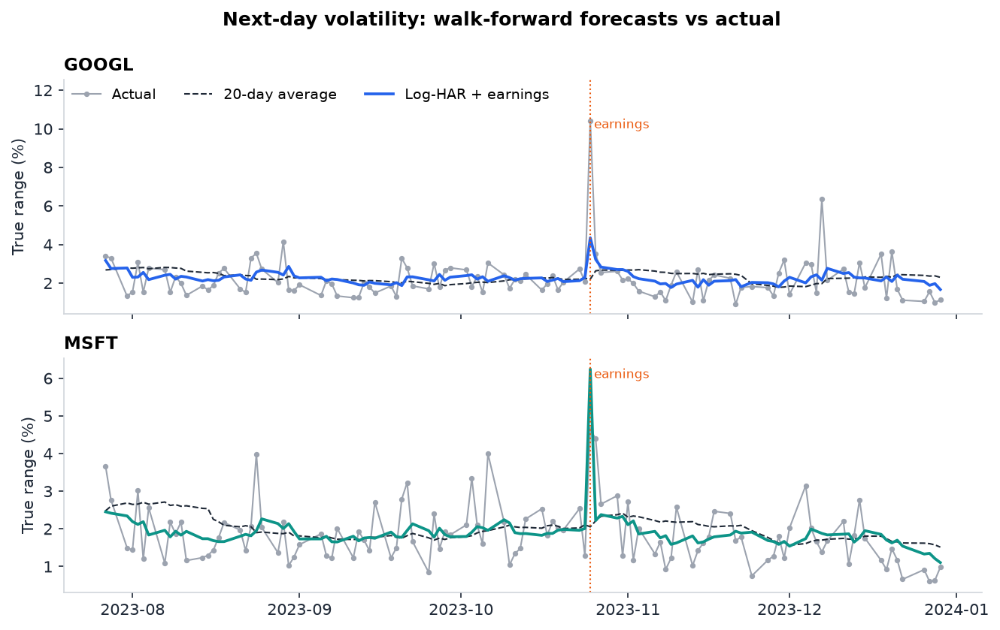
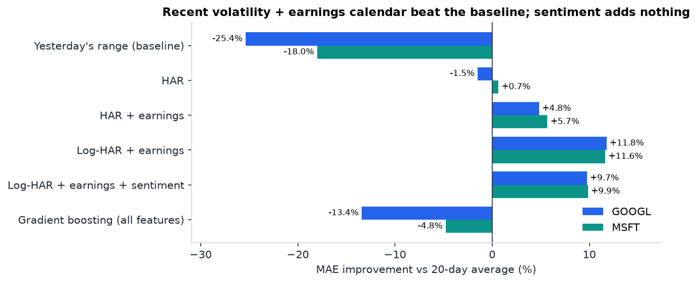

# Stock Sentiment Analysis: what news sentiment can and can't predict

This project started as "predict GOOGL and MSFT moves from news sentiment", and the first version reported 98% accuracy. That number didn't survive a closer look, so I rebuilt the evaluation from scratch. This README covers what went wrong, what the data actually supports, and the model that holds up.

**In short**

- **The 98% was leakage.** The label was computed from the model's own sentiment inputs, and the price model used same-day High/Low to "predict" the close.
- **Sentiment can't call tomorrow's direction.** Under an honest walk-forward test, every model lands at 38–56% accuracy, against a 53–55% majority-class baseline.
- **It's a better fit for volatility.** Predicting *how big* tomorrow's move will be works: a log-HAR model with the earnings calendar cuts forecast error by **12%** versus a 20-day average (skill R² **0.31** GOOGL, **0.24** MSFT), and still wins by about 10% on days with no earnings.



## What was wrong with the first version

| Issue | Effect |
|---|---|
| `Movement` was defined as `Positive - Negative > 0`, and both were model inputs | The classifier only had to rediscover its own label (97% / 95% when reproduced) |
| Same-day `Close` predicted from same-day `Open`, `High`, `Low` | R² 0.91 on GOOGL, yet `(High + Low) / 2` with no model scores 0.97 |
| "Google" and "Microsoft" news files are the same 46,043 general-news articles | Only 0.2% of headlines mention Google; there is no company signal to find |
| All of a day's text was concatenated and scored as one string | VADER saturates on long text; articles are now scored one at a time |

The trading metrics in the notebooks (Sharpe, win ratio) were built on the same labels, so they inherit the problem. I kept the original notebooks for reference, but their numbers shouldn't be read as results.

## Approach

**Data.** 2023 daily OHLCV for GOOGL and MSFT (250 sessions) and 46,043 news articles (headline + summary). Each article is scored with VADER. About 11% are tagged as market-relevant by keyword (rates, inflation, tech, earnings, and so on), so that subset can be tested on its own.

**No look-ahead.** Each article is assigned to the first session that closes after it was published: news after 4 pm ET counts toward the next day, and weekend news rolls into Monday. Every feature at day *t* uses only what was known at that day's close, and every target is day *t+1*.

**Evaluation.** Walk-forward: the model is refit each day on all earlier days and predicts the next one, giving 109 out-of-sample days per ticker (late July to December 2023). Every model is compared with a simple baseline, because a metric without one doesn't say much.

## Results

### 1. Direction: sentiment doesn't call it

| Features (logistic regression) | GOOGL acc | MSFT acc |
|---|---|---|
| Majority-class baseline | 55.0% | 53.2% |
| All-news sentiment | 46.8% | 52.3% |
| Market-news sentiment | 56.0% | 54.1% |
| Sentiment + recent price action | 51.4% | 47.7% |

Gradient boosting does worse (38–50%). The best result is within one day of the baseline on 109 days, which is noise. Day-to-day changes in sentiment have no measurable relationship with next-day returns.



### 2. Volatility: where the signal is

The target here is next-day **true range**, the high-to-low span including any overnight gap. The model is a HAR regression (1-, 5- and 20-day average ranges), a standard volatility baseline, plus a flag for the session after an earnings release. Earnings dates are announced weeks ahead, so the flag is known in advance.

| Model | MAE vs 20-day avg (GOOGL / MSFT) | Skill R² (GOOGL / MSFT) |
|---|---|---|
| Yesterday's range | −25.4% / −18.0% | −0.72 / −0.37 |
| HAR | −1.5% / +0.7% | +0.03 / +0.09 |
| HAR + earnings | +4.8% / +5.7% | +0.27 / +0.17 |
| **Log-HAR + earnings** | **+11.8% / +11.6%** | **+0.31 / +0.24** |
| Log-HAR + earnings + sentiment | +9.7% / +9.9% | +0.28 / +0.21 |
| Gradient boosting, all features | −13.4% / −4.8% | −0.07 / −0.01 |

Skill R² is measured against the 20-day average, so 0 means "no better than the baseline".



What the table says:

- **The earnings calendar drives the gain.** Recent ranges alone barely beat the 20-day average. Fitting in log space, which suits right-skewed volatility, adds the rest.
- **It isn't one lucky day.** On non-earnings days alone, skill R² is still 0.19 (GOOGL) and 0.20 (MSFT).
- **Sentiment makes it slightly worse.** It adds noise, not information.
- **Gradient boosting overfits.** With 100–230 training days, simple linear models win.



Full tables, including AUC for flagging high-volatility days, are in [results/summary.md](results/summary.md).

## Limitations

- One year, two tickers, 109 test days, and a single earnings event inside each test window. The direction of the result is clear; the exact size of the gain would move with more data.
- The news is a general feed, not company-specific, so the conclusion is about this feed rather than about news sentiment in general.
- VADER is a general-purpose lexicon; a finance-tuned model such as FinBERT may score headlines differently.
- Earnings dates for 2023 are hard-coded in `analysis/features.py`.

## Next steps

- Use ticker-tagged news and a finance-specific sentiment model, and test again for direction.
- Add market-wide volatility (VIX) and more tickers and years to the volatility model.

## Reproduce

```bash
pip install -r requirements.txt
python run_analysis.py
```

This regenerates `results/summary.md` and everything in `images/` in a couple of minutes.

## Repository layout

```
analysis/
  data.py          load prices and news, VADER scoring, align articles to sessions
  features.py      features and targets (no look-ahead), earnings calendar
  evaluate.py      audit of the first version, direction and volatility experiments
  plots.py         figures
run_analysis.py    runs everything
results/           summary.md with full metrics
images/            figures used above
Data-Set/          2023 prices and news
*.ipynb            original notebooks, kept for reference
```

## References

- Corsi, F. (2009). A Simple Approximate Long-Memory Model of Realized Volatility. *Journal of Financial Econometrics*, 7(2), 174–196.
- Hutto, C. and Gilbert, E. (2014). VADER: A Parsimonious Rule-based Model for Sentiment Analysis of Social Media Text. *ICWSM*.
- [Sentiment Indicator - Investopedia](https://www.investopedia.com/terms/s/sentimentindicator.asp)
- [Stock Market Sentiment Analysis Using Machine Learning - NCBI](https://www.ncbi.nlm.nih.gov/pmc/articles/PMC8659448/)
